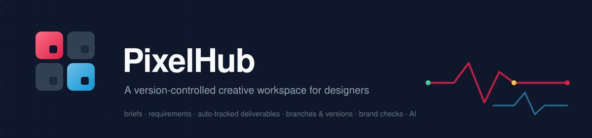
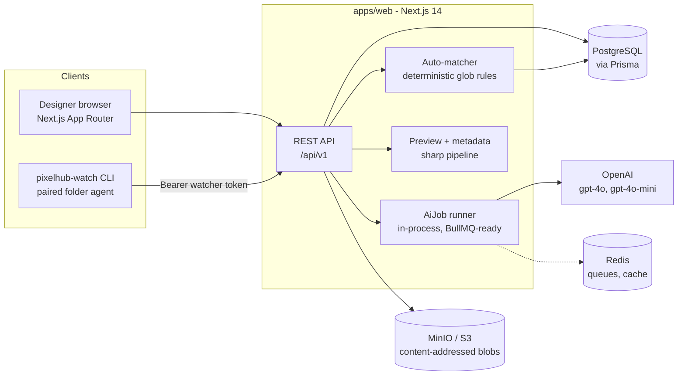
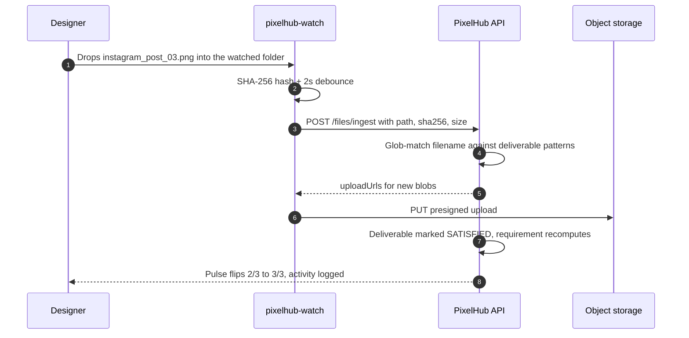
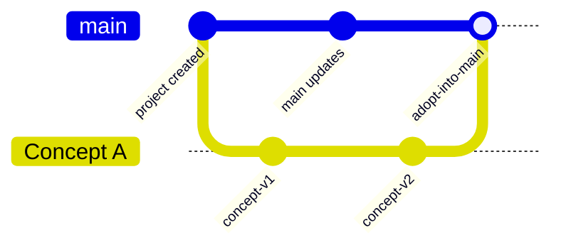
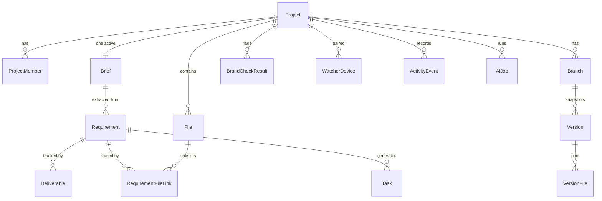

<div align="center">
  

  <br/>

  <a href="https://nextjs.org"></a>
  <a href="https://www.typescriptlang.org"></a>
  <a href="https://www.postgresql.org"></a>
  <a href="https://www.prisma.io"></a>
  <a href="https://tailwindcss.com"></a>
  <a href="https://www.docker.com"></a>
  
</div>

<br/>

**PixelHub is a version-controlled creative workspace for designers.** Think *GitHub × Notion × Figma project management × AI QA* — built around one idea: **project state should be derived from your files, not maintained by hand.**

Point it at a design folder, and it keeps everything honest: deliverables flip to fulfilled when the right export lands, requirements trace to the exact files that satisfy them, versions snapshot like commits, and brand drift gets flagged before the client sees it.

```text
export instagram_post_03.png  →  requirement flips 2/3 → 3/3 ✓  →  Pulse updates  →  activity logged
```

---

## 📖 Table of contents

| | | |
|---|---|---|
| [🧩 What is PixelHub?](#-what-is-pixelhub) | [✨ Feature highlights](#-feature-highlights) | [🖼 Product tour](#-product-tour) |
| [🏗 How it works](#-how-it-works) | [🧱 Tech stack](#-tech-stack) | [📦 Monorepo layout](#-monorepo-layout) |
| [🚀 Getting started](#-getting-started) | [🧭 Using PixelHub](#-using-pixelhub) | [🛰 pixelhub-watch CLI](#-pixelhub-watch-cli) |
| [🤖 AI workflows](#-ai-workflows) | [🔌 API overview](#-api-overview) | [🗄 Data model](#-data-model) |
| [🧪 Testing & verification](#-testing--verification) | [🛠 Useful scripts](#-useful-scripts) | [🗺 Roadmap](#-roadmap) |
| [📚 Documentation index](#-documentation-index) | [🧬 The making of this](#-the-making-of-this) | [🤝 Contributing](#-contributing) |

---

## 🧩 What is PixelHub?

Design work lives in folders — `brief.pdf`, `references/`, `exports/instagram_post_03.png`, `v2-final-FINAL.psd`. But project management lives somewhere else: a Notion doc, a checklist, a client email thread. The two drift apart immediately.

PixelHub makes the **file system the source of truth**:

- 🛰 **A watcher agent keeps a local folder in sync.** Files are SHA-256 hashed, deduplicated (content-addressed storage), and streamed to the server when new.
- 🎯 **Deliverables track themselves.** Requirements define deliverables with file patterns (`instagram_post_*.{png,jpg}`). When a matching file lands, the deliverable is satisfied — deterministically, no AI required.
- 🌿 **Versioning is designer-friendly.** Branches are *Concept / Revision / Experimental*; versions are snapshots you can compare, restore, and adopt into Main — no rebase terror.
- 🎨 **Brand rules are machine-readable.** A brand kit (colors with ΔE tolerance, fonts, logos, rules) powers checks that flag off-brand exports.
- 🤖 **AI is a proposal engine, not an autopilot.** It extracts requirements from briefs, explains version diffs in designer-English, generates task checklists — always as *proposals* you accept or dismiss.

---

## ✨ Feature highlights

| Feature | What it does |
|---|---|
| 📊 **Pulse dashboard** | Deliverables done/total, requirement coverage, open tasks, latest version, "needs attention" items, live activity feed, AI status narrative |
| 📋 **Brief & requirements** | Paste the client brief; add requirements with quantities, due dates, priorities and patterned deliverables; coverage + traceability per file |
| 🛰 **File watcher** | `pixelhub-watch` pairs a folder, scans/hashes, watches for changes (create/modify/delete/rename), uploads only what's new |
| 🎯 **Auto-tracking (the core loop)** | Glob matcher links new exports to deliverables → requirement coverage recomputes → Pulse flips to fulfilled |
| 🗂 **Files browser** | Searchable/filterable list, drag-drop upload, file detail (linked requirements, SHA-256, downloads), manual link/unlink, delete |
| 🌿 **Branches** | Main + Concept/Revision/Experimental, switch, rename, approve/abandon, fork-from-branch (copies head snapshot) |
| 📸 **Versions** | Snapshot with label + note, checksum dedupe ("no changes since v3"), timeline with compare selection, non-destructive restore |
| 🔀 **Adopt into Main** | Merge modal listing exactly which files will land; pick a subset or all; creates a merge version with provenance |
| 🔍 **Compare** | Mechanical diff (files added/removed/modified/renamed, colors, typography) + AI "designer-English" summary tab |
| 🎨 **Brand kit & checks** | Colors (roles + ΔE tolerance), fonts, logos, rules, guidelines text; "Run brand check" scans exports and lists findings with resolve/re-check |
| 🗂 **Design sheet** | Research board: notes, URLs, colors, project files — grouped into boards, linkable to requirements |
| ✅ **Tasks** | Board (To do / In progress / Done), manual or AI-generated checklists from requirements, requirement links, overdue highlighting |
| ⚙️ **Settings** | Project details, deadline/status, AI toggle, watcher device management, archive |

---

## 🖼 Product tour

Every project page lives under `/p/<slug>` and shares a header with the branch rail and tab navigation.

| Screen | Route | You can… |
|---|---|---|
| **Pulse** | `/p/<slug>` | See the health of the project at a glance. A *Get started* checklist walks new projects through brief → requirements → snapshot → watcher → files. |
| **Brief** | `/p/<slug>/brief` | Write/paste the brief, attach the brief document, ✨ extract requirements with AI (proposals arrive as PENDING cards), add/edit requirements with patterned deliverables, link files, re-match, generate tasks, filter by Fulfilled/Outstanding/Overdue. |
| **Versions** | `/p/<slug>/versions` | Branch rail + snapshot timeline + version detail. Snapshot, switch, approve, abandon, adopt into Main, restore, select two versions to compare. |
| **Compare** | `/p/<slug>/compare?base=…&target=…` | Base/target pickers, **Files** diff with status chips, **Colors** swatches, **Typography** fonts, **Summary** (AI). |
| **Design Sheet** | `/p/<slug>/design-sheet` | Add notes, URLs, color chips and project files; group into named boards; link references to requirements. |
| **Brand Kit** | `/p/<slug>/brand-kit` | Maintain the palette/fonts/logos/rules, run checks, expand findings (`expected vs found · ΔE`), resolve or re-check. |
| **Files** | `/p/<slug>/files` | Upload or drag-drop exports, search by name/path, filter by kind or branch, open file details, manage the watcher (pairing code + device list), link files to requirements. |
| **Tasks** | `/p/<slug>/tasks` | Kanban board with filters; create tasks manually or from ✨ *Generate tasks* on a requirement; move To do → Done; overdue at a glance. |
| **Settings** | `/p/<slug>/settings` | Rename, client, deadline, status, AI toggle, watcher devices (pair/revoke), archive. |

---

## 🏗 How it works



### The core loop (auto-tracked deliverables)



### Branching model



- **Branches** are friendly forks: `Concept` (explore a direction), `Revision` (client feedback round), `Experimental` (safe to break things). Forking copies the source head snapshot — branches never disturb each other's files.
- **Versions** are immutable snapshots holding file references + a checksum. Identical snapshots are rejected (`NO_CHANGES`), blobs dedupe by SHA-256 across branches and versions.
- **Adopt into Main** copies the selected files onto the target branch and creates a merge version that records `sourceBranch` + `sourceVersion` provenance.

---

## 🧱 Tech stack

| Layer | Technology | Badge |
|---|---|---|
| **Monorepo** | pnpm workspaces + Turborepo |   |
| **Runtime** | Node.js 20+ |  |
| **Language** | TypeScript (strict) |  |
| **Web app** | Next.js 14 App Router (UI + API routes) |   |
| **Styling** | Tailwind CSS |  |
| **Database** | PostgreSQL 15 + Prisma ORM |   |
| **Cache / queues** | Redis (BullMQ-ready) |  |
| **Object storage** | MinIO locally · S3 in prod (presigned URLs) |  |
| **Watcher CLI** | chokidar · commander · conf · p-queue |  |
| **Validation** | Zod contracts shared client/server |  |
| **AI** | OpenAI (`gpt-4o`, `gpt-4o-mini`) behind an `AiProvider` abstraction |  |
| **Images** | sharp (preview generation) |  |
| **Tests** | Vitest |  |
| **Dev infra** | Docker Compose (Postgres · Redis · MinIO) |  |

---

## 📦 Monorepo layout

```text
pixelhub/
├── apps/
│   ├── web/                        # Next.js 14 — UI (App Router) + REST API (/api/v1)
│   │   ├── app/
│   │   │   ├── api/v1/…            # 40+ route handlers (auth, projects, files, versions, AI…)
│   │   │   ├── p/[slug]/           # project shell: pulse, brief, versions, compare,
│   │   │   │                       #   design-sheet, brand-kit, files, tasks, settings
│   │   │   ├── (auth)/             # login · signup
│   │   │   └── app/                # project list + create
│   │   ├── components/             # ui kit, tabs, modals, per-feature client components
│   │   ├── lib/                    # api client, hashing, polling, utils
│   │   └── server/                 # modules (service/repo/router), auth, storage, http
│   └── watcher/                    # 🛰 pixelhub-watch — the folder agent CLI
│       └── src/                    # pair · scan/hash · watch loop · uploads · ignore rules
├── packages/
│   ├── types/                      # Zod contracts + enums shared everywhere
│   ├── db/                         # Prisma schema, migrations, seed
│   ├── ai/                         # AiProvider abstraction + OpenAI implementation
│   └── config/                     # shared tsconfig base
├── docs/                           # the full implementation plan (see index below)
├── docker-compose.yml              # Postgres · Redis · MinIO + bucket bootstrap
└── turbo.json
```

---

## 🚀 Getting started

### Prerequisites

| Requirement | Notes |
|---|---|
| 🟢 **Node.js ≥ 20** | `node -v` |
| 📦 **pnpm 9** | comes via `corepack enable` (repo pins `pnpm@9.6.0`) |
| 🐳 **Docker Desktop** | for Postgres, Redis, MinIO |
| 🔑 **OpenAI API key** *(optional)* | only needed for AI features — everything else works without it |

### 1 · Install & configure

```bash
corepack enable
pnpm install

# copy the environment template
cp .env.example apps/web/.env.local          # macOS / Linux
copy .env.example apps\web\.env.local        # Windows (cmd)
```

### 2 · Start the infrastructure

```bash
pnpm docker:up        # postgres:5432 · redis:6379 · minio:9000 (console :9001)
```

The `minio-init` container creates the `pixelhub` bucket automatically.

### 3 · Prepare the database

```bash
pnpm db:generate                            # generate the Prisma client
pnpm --filter @pixelhub/db run deploy       # apply migrations
# optional: pnpm db:seed                    # demo project with files + versions
```

### 4 · Run 🎉

```bash
pnpm dev                                    # turbo → web on http://localhost:3000
# or, if turbo can't locate pnpm in a fresh shell:
pnpm --filter @pixelhub/web dev
```

Open **http://localhost:3000**, sign up, and create your first project. The Pulse page's **Get started** checklist will walk you through the rest.

---

## 🧭 Using PixelHub

### The 5-minute path to your first auto-tracked deliverable

1. **Create a project** — `/app/new`. A *Main Concept* branch and an empty *Brand Kit* are created automatically.
2. **Paste the brief** — go to **Brief**, paste the client brief, hit **Save brief**. (With an OpenAI key you can also hit **Extract requirements** and accept/dismiss AI proposals.)
3. **Add a requirement** — **+ Add requirement**: title, quantity, due date, priority, and deliverables with file patterns, e.g.
   `Post 1 → instagram_post_01.png`, `Post 2 → instagram_post_02.png`, `Post 3 → instagram_post_03.png`.
4. **Pair your folder** — open **Settings → Watcher devices → Pair this folder** (or the pill on **Files**) and generate an 8-character code.
5. **Run the watcher** in your design folder (see the next section) — it pairs, scans, and starts syncing. Drop `instagram_post_01.png` and `instagram_post_02.png` in; the requirement moves to **2/3**.
6. **Drop the last export** — the Pulse tile flips to **3/3 ✓**, the requirement turns **FULFILLED**, and the activity feed records it. That's the loop.

### Everyday workflows

- **Publish a milestone** → **Versions → Snapshot current state** (label + note). Checksums prevent empty duplicates.
- **Explore a direction safely** → **Versions → + New branch** (Concept) → *Switch to* → work → **Adopt into Main** when approved (choose exactly which files carry over).
- **Answer "what changed?"** → select two versions → **Compare selected** → Files / Colors / Typography tabs + AI summary.
- **Catch brand drift** → **Brand Kit**: add palette (with ΔE tolerance), fonts, logos, rules → **Run brand check** → review findings per file, resolve or re-check.
- **Turn promises into work** → on a requirement: **Generate tasks** (AI checklist) → track on the **Tasks** board.
- **Collect evidence** → **Design Sheet**: notes, URLs, colors, project files — linked to requirements.

---

## 🛰 pixelhub-watch CLI

The agent that keeps a local folder and PixelHub in sync. Two commands:

| Command | What it does |
|---|---|
| `pixelhub-watch pair` | Exchanges a pairing code for a project-scoped token, writes `.pixelhub/config.json`, then starts watching |
| `pixelhub-watch` *(default)* / `start` | Watches the folder: scan → reconcile with server manifest → chokidar watch → debounced ingest → uploads → heartbeat every 60s |

| Flag | Commands | Description | Default |
|---|---|---|---|
| `--server, -s <url>` | `pair` | PixelHub server URL | `http://localhost:3000` |
| `--code, -c <code>` | `pair` | Pairing code from the web UI (skips the prompt) | prompt |
| `--root, -r <path>` | `pair`, `start` | Folder to watch | current directory |
| `--name, -n <name>` | `pair` | Device name shown in the UI | hostname |

### Run it from this repo

```bash
# one-time build
pnpm --filter @pixelhub/watcher build

# inside the folder you want to watch
node /path/to/pixelhub/apps/watcher/dist/index.js pair --server http://localhost:3000

# or straight from source (no build step)
pnpm --filter @pixelhub/watcher exec tsx src/index.ts pair --server http://localhost:3000
```

You'll see output like:

```text
Paired "C:\work\launch-campaign" with project "launch-campaign".
Watching C:\work\launch-campaign
Project: launch-campaign · server http://localhost:3000
Initial scan: 3 files (0 already in sync).
Syncing 3 changes…
Uploaded 3 blobs.
Everything is in sync. Watching for changes…
Synced 1 change (1 uploaded).          ← drop a new export, watch it sync
```

### What the watcher handles

- 🔐 **Pairing & auth** — project-scoped bearer token, stored in your OS config dir; revocation is detected and reported with a re-pair hint.
- 🔍 **Initial scan** — recursive walk honoring ignore rules; SHA-256 every file; only differences are sent (server manifest reconciliation).
- 👀 **Watch loop** — chokidar with `awaitWriteFinish` (750ms) + 2s event debouncing (survives export storms).
- 🔁 **Rename detection** — `unlink` + `add` with the same hash collapses into one `moved` event.
- ⬆️ **Uploads** — only blobs the server doesn't have (content-addressed dedupe), 4-way concurrency, 5 retries with exponential backoff.
- 🚫 **Ignore rules** — server defaults (`.git`, `node_modules`, `.pixelhub`, `*.tmp`, `~$*`, `.DS_Store`, `Thumbs.db`) + your own `.pixelhubignore` (gitignore-style, one pattern per line).
- 💓 **Heartbeat** — pings every 60s so the UI status pill shows "last seen".

---

## 🤖 AI workflows

All AI runs through an `AiProvider` abstraction with a generic `AiJob` lifecycle (`QUEUED → RUNNING → SUCCEEDED/FAILED`) and a **proposal pattern**: AI proposes, you accept or dismiss. Set `OPENAI_API_KEY` in `apps/web/.env.local` to enable; without it, jobs fail gracefully and every deterministic feature keeps working.

| Job | Trigger | Output |
|---|---|---|
| `EXTRACT_REQUIREMENTS` | **Brief → Extract requirements** | PENDING requirement proposals with deliverables/patterns, accepted or dismissed |
| `COMPARE_VERSIONS` | **Compare** (auto-enqueued) | Designer-English summary stored on the comparison + per-change cards |
| `GENERATE_TASKS` | **Requirement → Generate tasks** | Task checklist (`TODO`) linked to the requirement |
| `BRAND_CHECK` | **Brand Kit → Run brand check** / new exports | `BrandCheckResult` findings per file (`expected vs found`, ΔE, severity) |
| `MATCH_FILE` | Fallback when rules match nothing (opt-in) | Suggested file → deliverable links (accepted at ≥ 0.85 confidence) |
| `PROJECT_STATUS_NARRATIVE` | **Pulse → AI narrative tile** | Plain-language project status paragraph |

---

## 🔌 API overview

REST under `/api/v1` — Zod-validated bodies, uniform error envelope `{ error: { code, message, details? } }`, session cookies for the web app and bearer tokens for watchers. Highlights:

| Area | Endpoints |
|---|---|
| 🔐 Auth | `POST /auth/signup` · `POST /auth/login` · `POST /auth/logout` · `GET /auth/me` |
| 📁 Projects | `GET/POST /projects` · `GET/PATCH/DELETE /projects/:id` · `GET /projects/:id/pulse` · `GET /projects/:id/activity` |
| 📋 Brief & requirements | `GET/PUT /projects/:id/brief` · `POST /projects/:id/brief/extract` · `GET/POST /projects/:id/requirements` · `PATCH/DELETE /requirements/:id` · `POST /requirements/:id/deliverables` · `POST /requirements/:id/link-file` · `POST /requirements/:id/generate-tasks` |
| 🗂 Files | `GET/POST /projects/:id/files` · `POST /projects/:id/files/{upload-url,confirm,ingest}` · `GET /files/:id` · `GET /files/:id/download` · `POST /files/:id/recheck-brand` |
| 🌿 Branches & versions | `GET/POST /projects/:id/branches` · `PATCH /branches/:id` · `POST /branches/:id/{switch,versions,merge}` · `GET /versions/:id` · `POST /versions/compare` |
| 🎨 Brand kit | `GET/PUT /projects/:id/brand-kit` · `POST /projects/:id/brand-kit/check` · `GET /projects/:id/brand-checks` · `POST /brand-checks/:id/resolve` |
| 🗂 Design sheet | `GET/POST /projects/:id/design-sheet` · `PATCH/DELETE /design-sheet/:itemId` · `POST /projects/:id/design-sheet/positions` |
| ✅ Tasks | `GET/POST /projects/:id/tasks` · `PATCH /tasks/:id` |
| 🛰 Watchers | `GET/POST /projects/:id/watchers/pair` · `GET /projects/:id/watchers` · `DELETE /watchers/:id` · `POST /watchers/exchange` · `GET /watchers/config` |
| 🤖 AI | `GET /ai-jobs/:id` · `GET/POST /projects/:id/ai-jobs` · `POST /projects/:id/ai/status-narrative` |

---

## 🗄 Data model

Simplified — the full schema lives in [`packages/db/prisma/schema.prisma`](packages/db/prisma/schema.prisma) and is documented in [`docs/02-database-schema.md`](docs/02-database-schema.md).



**Guiding rule:** progress is always *derived on read* (`Deliverable.status`, `RequirementFileLink`) — never stored as mutable counters. That's why coverage can never drift from the actual files.

---

## 🧪 Testing & verification

```bash
pnpm typecheck      # tsc across every workspace
pnpm lint           # eslint (web) + tsc (packages)
pnpm test           # vitest — watcher unit tests + workspace suites
```

**Watcher unit tests** cover the risky logic: ignore-rule matching (`.git`/`node_modules` anywhere, glob rules, `.pixelhubignore`, comment/negation handling) and rename detection (hash-collapse of `unlink`+`add`, no double-matching).

**End-to-end acceptance run** (against Docker + dev server + a real watched folder) verified:

- ✅ Pairing → initial scan → 3 blobs uploaded to MinIO → download returns exact bytes
- ✅ Requirement coverage **2/3** after two matching exports
- ✅ Dropping `instagram_post_03.png` flips it to **3/3 · FULFILLED** · Pulse 100%
- ✅ Rename (`moved`), delete (`deleted`), and modify (new revision, re-bound deliverable) all sync correctly
- ✅ All nine project screens (including compare) render with live data

---

## 🛠 Useful scripts

| Script | What it does |
|---|---|
| `pnpm dev` | Run all dev servers (web) via Turborepo |
| `pnpm build` | Production build for all workspaces |
| `pnpm typecheck` / `pnpm lint` / `pnpm test` | Quality gates |
| `pnpm format` | Prettier across the repo |
| `pnpm docker:up` / `pnpm docker:down` | Start/stop Postgres · Redis · MinIO |
| `pnpm db:generate` | Prisma client generation |
| `pnpm db:migrate` | Create/apply a dev migration |
| `pnpm --filter @pixelhub/db run deploy` | Apply migrations (CI/deploy style) |
| `pnpm db:seed` | Seed demo data |
| `pnpm db:studio` | Prisma Studio |

---

## 🗺 Roadmap

- [x] **Phase 0** — monorepo, Docker infra, Prisma schema + migration, auth, activity events
- [x] **Phase 1 (MVP)** — project core & Pulse, brief/requirements with traceability, watcher CLI + ingest pipeline + auto-matching, branches/versions/merge/compare, brand kit + checks UI, minimal AI (extraction) — *core loop verified end-to-end*
- [ ] **Phase 1 remaining** — `sharp` preview generation + `imageMeta` (fills Compare colors/typography), deterministic ΔE checker, CI pipeline, watcher offline queue & branch-switch reconciliation
- [ ] **Phase 2** — client review portal & comments, decision log, roles/permissions matrix + invitations, deeper AI (self-verification, task generation UX), analytics insight cards
- [ ] **Phase 3** — portfolio analytics, branch graph visualization, desktop installer (Tauri), Figma/Adobe & Slack integrations

Full breakdown: [`docs/10-roadmap.md`](docs/10-roadmap.md)

---

## 📚 Documentation index

The complete implementation plan lives in [`docs/`](docs/) — cross-referenced and self-contained:

| # | File | Contents |
|---|---|---|
| 00 | [docs/00-overview.md](docs/00-overview.md) | Pitch, feature checklist → doc map, guiding principles |
| 01 | [docs/01-architecture.md](docs/01-architecture.md) | Tech stack, system components, monorepo layout, data flows |
| 02 | [docs/02-database-schema.md](docs/02-database-schema.md) | Full PostgreSQL schema — every table, column, relation, index |
| 03 | [docs/03-backend-api.md](docs/03-backend-api.md) | Backend modules, all REST endpoints, background jobs, logic |
| 04 | [docs/04-frontend-ui-buttons.md](docs/04-frontend-ui-buttons.md) | Every screen, every button and exactly what it does |
| 05 | [docs/05-versioning-branching.md](docs/05-versioning-branching.md) | Designer-friendly Git-style versioning & branching model |
| 06 | [docs/06-file-watcher.md](docs/06-file-watcher.md) | The watcher agent + auto-deliverable tracking |
| 07 | [docs/07-ai-workflows.md](docs/07-ai-workflows.md) | AI assistant: extraction, comparison, brand checks, tracking |
| 08 | [docs/08-analytics.md](docs/08-analytics.md) | The analytics layer underlying the product |
| 09 | [docs/09-roles-permissions.md](docs/09-roles-permissions.md) | Owner / Contributor / Reviewer / Client permission matrix |
| 10 | [docs/10-roadmap.md](docs/10-roadmap.md) | MVP scope, milestones, task breakdown, acceptance criteria |

Reading order: `00` (what & why) → `01` (system) → `02`+`03` (data & API) → `04` (UI) → `05`+`06` (versioning & tracking) → `07` (AI) → `08` (analytics) → `09` (permissions) → `10` (plan/roadmap).

---

## 🧬 The making of this

PixelHub started as a written idea and was built in layers, plan-first:

1. **📝 The plan** — ten cross-referenced documents (`docs/00`–`docs/10`) specify the pitch, architecture, database, API, every UI button, the watcher protocol, AI contracts, analytics, permissions and a phased roadmap. The docs are the spec; the code follows them.
2. **🏗 Foundations** — pnpm + Turborepo monorepo, full Prisma schema + migration, and the complete backend API (auth, projects, files, branches/versions, requirements, brand kits, design sheet, tasks, AI jobs) with a Pulse dashboard.
3. **🎨 The app surfaces** — nine project screens built against the Zod contracts: brief/requirements with AI extraction proposals, files with watcher pairing, versions with the adopt-into-main merge modal, compare with mechanical + AI diffs, brand kit with checks, design sheet, tasks, settings — plus a getting-started checklist so new projects explain themselves.
4. **🛰 The watcher** — `pixelhub-watch` went from scaffold to a real agent: pairing, manifest reconciliation, hashing, debounced watching with rename detection, deduped presigned uploads, heartbeats.
5. **🧪 The live run** — the whole loop was exercised end-to-end on a real folder. The run exposed and fixed real bugs:

| 🐞 Bug found in the live run | 🔧 Fix |
|---|---|
| Pairing codes lived in per-route module state — `pair` and `exchange` never saw the same map in dev | `globalThis` singleton (same pattern as the Prisma client) |
| Streamed S3 PUTs failed with **411 Length Required** | Watcher sends explicit `Content-Length` |
| Modifying a file left deliverables pointing at the soft-deleted revision | Matcher now re-binds "stale" satisfied deliverables and marks the old link `SUPERSEDED` |
| MinIO image pull/healthcheck flakiness in Compose | `quay.io` images + resilient `minio-init` wait loop |

The result is a working MVP whose headline promise holds: **drop the right file, and the project tells you the truth.**

---

## 🤝 Contributing

This is an MVP in active development. Issues and pull requests are welcome — the docs in [`docs/`](docs/) define intended behavior, and `pnpm typecheck && pnpm lint && pnpm test` should stay green.

<div align="center">
  <br/>
  
  <br/>
  <sub><b>PixelHub</b> — briefs in, deliverables out, no drift in between.</sub>
</div>
